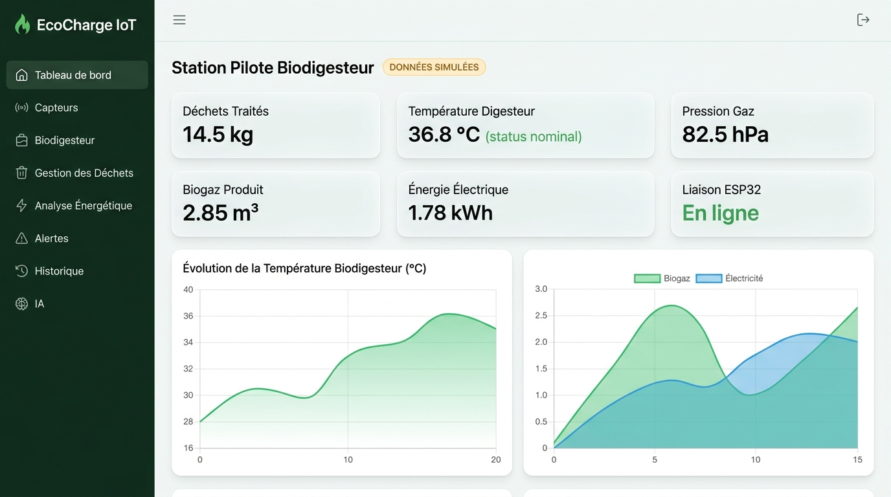
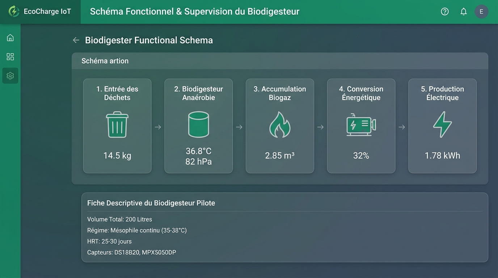

# ⚡ EcoCharge — Système Intelligent de Supervision & Valorisation Énergétique

Projet IoT full-stack professionnel développé pour les étudiants, enseignants et jurys en **Systèmes Embarqués, Internet des Objets (IoT), Énergies Renouvelables et Supervision Industrielle**.

---

## 📸 Aperçu de l'Application

### 1. Tableau de Bord Général Temps Réel
Supervision des métriques clés (déchets, température, pression, volume de biogaz, électricité), courbes chronologiques interactives et bascule automatique de statut matériel.



### 2. Schéma Fonctionnel du Biodigesteur & Supervision du Procédé
Visualisation séquentielle en 5 étapes de la méthanisation anaérobie mésophile et fiche descriptive du réacteur pilote (200 L).



---

## 🌟 1. Présentation & Rôle du Projet

### Qu'est-ce qu'EcoCharge ?
**EcoCharge** est une plateforme industrielle et académique dédiée au monitoring temps réel de la valorisation énergétique des biodéchets. Elle permet de suivre précisément chaque étape de la transformation de matières organiques en vecteur énergétique :

```text
[ Biodéchets (kg) ] ──(Tri & Pesée)──▶ [ Biodigesteur Mésophile (35-38°C) ] ──(Méthanisation)──▶ [ Biogaz (CH₄) ] ──(Génératrice ~32%)──▶ [ Électricité (kWh) ]
```

En parallèle, l'infrastructure IoT assure une acquisition continue et non-intrusive :

```text
[ Banc de Capteurs ] ──(OneWire / ADC / I2C)──▶ [ ESP32 (Wi-Fi 802.11) ] ──(HTTP REST / JSON)──▶ [ API Express ] ──▶ [ Base SQLite ] ──(Polling 5s)──▶ [ Dashboard React 19 ]
```

---

## 🛡️ 2. Principes Déontologiques & Sécurité Industrielle

1. **Authenticité Rigoureuse des Données :**
   * Lorsque l'ESP32 physique émet des trames valides, le système affiche le badge vert **« MATÉRIEL CONNECTÉ (ESP32) »**.
   * Lorsque le matériel n'est pas branché, le moteur interne génère des fluctuations thermodynamiques réalistes clairement étiquetées avec le badge ambre **« DONNÉES SIMULÉES »**.
   * Le système ne travestit jamais une simulation en mesure réelle.

2. **Sécurité Passive & Non-Intrusive :**
   * L'interface web est un outil de **monitoring et d'alerte**.
   * Conformément aux normes de sécurité sur les gaz inflammables ($\text{CH}_4$), **aucune commande distante d'ouverture de vanne, de mise sous pression forcée ou d'allumage n'est exposée sur le réseau**.
   * La sécurité physique de la cuve repose sur une soupape mécanique calibrée à $150\text{--}180\text{ hPa}$.

---

## 🏗️ 3. Architecture & Structure du Dépôt

```
ecocharge/
├── backend/                       # Serveur API REST Node.js / Express
│   ├── src/
│   │   ├── db/                   # Connexion SQLite, migrations et schéma
│   │   ├── middleware/           # Sécurité JWT et authentification
│   │   ├── routes/               # Endpoints REST (auth, télémétrie, capteurs, déchets, etc.)
│   │   └── services/             # Simulateur cinétique, évaluateur d'alertes & IA
│   ├── package.json
│   └── server.js                 # Point d'entrée de l'API (port 4000)
├── frontend/                      # Interface Web React 19 + Vite + Tailwind CSS
│   ├── src/
│   │   ├── api/                  # Client HTTP centralisé (fetch)
│   │   ├── components/           # Composants UI (Layout, MetricCard, StatusBadge)
│   │   ├── context/              # Gestion d'état et session AuthContext
│   │   └── pages/                # Les 9 pages fonctionnelles du dashboard
│   ├── package.json
│   └── vite.config.js
├── firmware/                      # Code source embarqué ESP32
│   └── ecocharge_esp32/
│       ├── ecocharge_esp32.ino    # Script principal Arduino C++
│       ├── config.h               # Assignation des broches (pinout) et seuils
│       ├── secrets.example.h      # Gabarit Wi-Fi et URL du serveur
│       └── platformio.ini         # Configuration PlatformIO
├── database/                      # Fichier SQLite persistant (ecocharge.db)
├── docs/                          # Documentation technique complète
│   ├── screenshots/              # Captures d'écran de l'application
│   ├── ARCHITECTURE.md            # Diagrammes d'architecture et flux
│   ├── API.md                     # Documentation exhaustive des 12 routes REST
│   ├── BUDGET_COMPOSANTS.md       # Nomenclature et budget matériel (~71 €)
│   ├── TESTS.md                   # Scénarios de validation pour jury
│   └── TROUBLESHOOTING.md         # Guide de résolution des pannes
└── package.json                   # Scripts racine du projet
```

---

## 🚀 4. Guide de Démarrage Rapide

### Prérequis
* **Node.js** version 18 ou supérieure (v20 / v24 recommandées).
* **PowerShell** ou Terminal bash.

### Démarrage en 2 commandes

#### Étape 1 : Lancer le Backend (API REST & Base SQLite)
Ouvrez un premier terminal :
```powershell
cd backend
npm.cmd install
node server.js
```
> Le serveur écoute sur `http://localhost:4000`. La base de données `database/ecocharge.db` est auto-initialisée avec l'utilisateur et les capteurs par défaut.

#### Étape 2 : Lancer le Frontend (Vite + React)
Ouvrez un deuxième terminal :
```powershell
cd frontend
npm.cmd install
npm.cmd run dev
```
> L'interface web démarre instantanément sur `http://localhost:5173`.

---

## 👤 5. Identifiants de Démonstration

L'application inclut un compte administrateur local pré-configuré (un bouton de remplissage automatique est disponible sur la page de connexion) :

| Identifiant | Valeur |
| :--- | :--- |
| **Email** | `etudiant@ecocharge.local` |
| **Mot de passe** | `EcoCharge2026!` |
| **Rôle** | Administrateur / Opérateur |
| **Sécurité** | Hachage sécurisé bcrypt, jetons JWT valides 24h |

---

## 🧭 6. Détail des Pages & Fonctionnalités

| Page | Description détaillée |
| :--- | :--- |
| **Tableau de Bord** | 7 cartes de métriques instantanées, détection de liaison ESP32, graphiques Recharts (température sur 24h, ratio biogaz/électricité), boutons d'injection d'anomalies de test. |
| **Capteurs** | Supervision unitaire des 6 instruments de mesure (DS18B20, MPX5050DP, JSN-SR04T, HX711, YF-S401, PZEM-004T). Possibilité d'activer/désactiver chaque sonde et d'éditer ses seuils min/max. |
| **Biodigesteur** | Chaîne séquentielle en 5 étapes (intrants $\to$ digesteur $\to$ biogaz $\to$ conversion $\to$ électricité), caractéristiques techniques (cuve CSTR 200L, HRT 25-30j) et journal d'interventions. |
| **Gestion des Déchets** | Formulaire d'enregistrement des intrants (masse, nature organique, provenance, notes), compteurs périodiques (aujourd'hui, 7 jours, 30 jours, total) et **export au format CSV**. |
| **Analyse Énergétique** | Calcul du bilan thermodynamique à partir du Pouvoir Calorifique Inférieur (PCI biogaz $\approx 6.0\text{ kWh/m}^3$), rendement de conversion ($\approx 32.5\%$) et **export CSV**. |
| **Centre d'Alertes** | Journalisation et filtrage des alertes (info, avertissement, critique) avec horodatage précis et bouton d'acquittement pour l'opérateur. |
| **Historique & Logs** | Table chronologique complète des trames reçues avec moteur de recherche textuelle, filtre par source (matériel vs simulation) et pagination. |
| **Module IA & Prédiction** | Modélisation cinétique de van 't Hoff / Arrhenius, diagnostic thermique mésophile et courbe de projection prévisionnelle de production à $+48\text{h}$. |
| **Paramètres** | Configuration du nom du site, sélection des unités (°C/K, hPa/bar), délais de timeout et interrupteur marche/arrêt du simulateur. |

---

## 🧪 7. Démonstration pour Soutenance / Jury

Pour démontrer la robustesse du système lors d'un examen ou d'une soutenance de TP :

1. **Validation du comportement nominal :**
   * Observez le polling automatique toutes les 5 secondes sur le Dashboard.
   * La température oscille naturellement autour de $36.8^\circ\text{C}$ et la pression autour de $82\text{ hPa}$.
2. **Test d'anomalie de surchauffe :**
   * Sur le Dashboard, cliquez sur **« ⚠️ Test Surchauffe »**.
   * La température passe à $43.5^\circ\text{C}$ (dépassement du seuil de $40^\circ\text{C}$).
   * Une alerte critique rouge apparaît instantanément dans la barre supérieure et sur la page **Alertes**.
3. **Test d'anomalie de surpression :**
   * Cliquez sur **« ⚡ Test Surpression »**.
   * La pression monte à $165\text{ hPa}$ (seuil critique de la soupape mécanique dépassé).
4. **Réinitialisation :**
   * Cliquez sur **« Réinitialiser »** pour revenir au régime stable.
5. **Enregistrement et Export :**
   * Rendez-vous sur la page **Déchets**, ajoutez $8.5\text{ kg}$ de déchets alimentaires et téléchargez le rapport CSV en un clic.

---

## 🔌 8. Raccordement de l'ESP32 Réel

Pour connecter la carte physique :
1. Branchez les capteurs sur l'ESP32 selon le pinout défini dans [config.h](file:///c:/Users/PC/Desktop/lisi3/ecocharge/firmware/ecocharge_esp32/config.h).
2. Dupliquez [secrets.example.h](file:///c:/Users/PC/Desktop/lisi3/ecocharge/firmware/ecocharge_esp32/secrets.example.h) sous le nom `secrets.h`.
3. Indiquez votre SSID Wi-Fi, mot de passe et l'adresse IP locale de votre machine :
   ```cpp
   #define WIFI_SSID "Mon_WiFi"
   #define WIFI_PASSWORD "Mon_Mot_De_Passe"
   #define API_SERVER_URL "http://192.168.1.50:4000/api/telemetry"
   ```
4. Flashez le firmware via l'IDE Arduino ou PlatformIO.
5. Dès que l'ESP32 émet, le badge passe automatiquement à **« MATÉRIEL CONNECTÉ (ESP32) »**.

---

## 📚 9. Documentation Complémentaire

* 📐 [Architecture logicielle et flux de données](file:///c:/Users/PC/Desktop/lisi3/ecocharge/docs/ARCHITECTURE.md)
* 📡 [Spécification complète de l'API REST](file:///c:/Users/PC/Desktop/lisi3/ecocharge/docs/API.md)
* 💰 [Nomenclature et budget des composants (~71 €)](file:///c:/Users/PC/Desktop/lisi3/ecocharge/docs/BUDGET_COMPOSANTS.md)
* 🔧 [Guide de câblage et flashage de l'ESP32](file:///c:/Users/PC/Desktop/lisi3/ecocharge/firmware/ecocharge_esp32/README.md)
* 🧪 [Protocole de test pour jury d'évaluation](file:///c:/Users/PC/Desktop/lisi3/ecocharge/docs/TESTS.md)
* 🛠️ [Guide de dépannage et diagnostic réseau](file:///c:/Users/PC/Desktop/lisi3/ecocharge/docs/TROUBLESHOOTING.md)

---
*Projet développé pour validation académique — Promotion IoT & Systèmes Embarqués 2026.*
